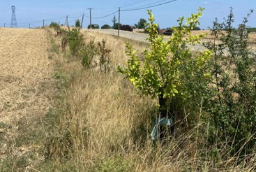

# Modèle de dépôt Github pour les standards CNIG

> [!IMPORTANT]
> **Attention** : Le modèle de fichier README débute après ce paragraphe. Dans la suite,
>
> * toutes les consignes en citation, comme cette ligne, doivent être supprimées,
> * tout ce qui est <mark>_surligné_</mark> doit être remplacé.
>
> Vous trouverez l'ensemble des consignes et conseils pour utiliser ce modèle de dépôt sur [cette page de la documentation](https://app.gitbook.com/o/w6D6SnLwCXQaMMSzcTvp/s/weZQRU1RV5So9WzNyxlW/~/changes/19/la-fabrique-des-standards/realisation-du-standard/utiliser-le-modele-de-depot-github). 

---
<!-- Supprimer les trois tirets précédents (qui insèrent une ligne) -->

# Groupe de Travail CNIG Haie: Standard de données "Plantation de haies"

> _Insérer une description du standard et des données concernées en quelques lignes. Ici comme dans la suite, il est recommandé de réutiliser le contenu du mandat du GT ou d'autres documents déjà rédigés. Voici plusieurs exemples pour vous inspirer dans la rédaction :_
>
> * _[standard des opération d'aménagement](https://github.com/cnigfr/schema-operations-amenagement/)_
> * _[standard risques](https://github.com/cnigfr/Geostandards-Risques)._
>
> _Afin de clarifier la lecture de cette description sur le site schema.data.gouv, préciser ici lorsque le standard n'est pas accompagné d'un schéma sur schema.data.gouv:_
>

Ce standard CNIG possèdera très prochainement un schéma de données directement accessible sur schema.data.gouv.fr. 
Davantage de documentation peut être trouvée sur le site du CNIG au lien suivant : https://cnig.gouv.fr/gt-haies-a30201.html.

## Contexte

> Le présent document a pour objectif de faciliter l’échange de données sur les plantations de haies afin d’améliorer la connaissance de ces linéaires. L’information principale récupérée est le tracé du linéaire de plantation et des informations complémentaires.
En effet, l’observatoire de la haie produit un référentiel cartographique de données socle des haies BDHaie v3 par photo-interprétation. Le standard « Plantation de Haies » permet de récupérer des informations sur les linéaires non identifiables par cette technique, les plantations étant des jeunes haies en devenir non visibles par imagerie aérienne. Ainsi, les données remontées par le standard sont complémentaires à ce référentiel de données socle et améliore la connaissance de la répartition de ces objets sur le territoire.
De plus, de nombreux programmes de subvention et d’action ont été menées sur fond public pour favoriser la plantation de haies : ce standard permet de remonter des informations complémentaires sur le financement et quelques caractéristiques de la plantation afin de suivre l’action des politiques publiques. Il permettra également de calculer des indicateurs de suivi des haies comme :
> -	Le gain net en mètre linéaire de haies lié aux politiques publiques ;
> -	Le taux de survie des plantations sur le temps long ;
> -	Le nombre de mètres linéaires dédiés à la régénération naturelle assistée ;
> -	L’impact du nombre de rangs sur le succès des plantations.
> L’élaboration du standard a pris en compte la faisabilité de la standardisation à partir des données existantes. En effet, de nombreux acteurs publics et privés interviennent sur la « haie » au titre de différentes politiques publiques. Ainsi, suivant les objectifs de ces acteurs et les dynamiques dans les territoires, de nombreuses données existent mais sont très hétérogènes. Certaines données à la base administrative, récoltées pour des calculs de subvention doivent être remobilisées au titre de la connaissance. Ce standard se veut être équilibré entre l’effort de récupération des données existantes et les bonnes pratiques pour le futur. Les méthodologies, les approches par territoires sont très hétérogènes et le standard n’a pas vocation à modifier les organisations et méthodologies mises en place.

> Il n’existait pas de standard de données sur les plantations de haie. Ce premier standard permet une mise en commun de ces données au niveau national, ce qui représente une grande plus-value. 

## Cadre juridique

> _Citer les textes liés aux données sur lesquelles porte le schéma. Même lorsque l'utilisation du schéma n'est pas mentionnée dans les textes, il peut être utile de faire référence ici aux lois, décrets, arrêtés portant spécifiquement sur les données, leurs conditions de collecte, de partage, etc. Il n'est pas utile de citer les textes plus généraux (portant sur l'open data par exemple)._

## Finalité

> _Les enjeux et objectifs liés à la création du standard doivent être précisés ici._

## Cas d’usage

> _Présenter ici quelques cas d'usage de données conformes au schéma. Ces cas peuvent exister ou être fictifs._

## Organisation du dépôt

* Le dossier [ressources](ressources) contient les documents utiles pour les utilisateurs du standard ;
* Le dossier [groupe_de_travail_CNIG](groupe_de_travail_CNIG) contient les comptes-rendus de réunions et les documents de suivi du groupe de travail ;
* Le dossier [standard](standard) contient le standard ainsi que les documents qui lui sont liés ;

> _A supprimer en l'absence de schéma JSON :_

* Le dossier [schéma](schéma) contient le schéma ainsi que les documents qui lui sont liés.

## Modalités de production des données

> La plupart de ces données sont produites dans un cadre administratif, notamment lors de demande de subvention de plantation.
> Le standard permet de considérer et de conserver ces données pour une améliorer la connaissance des plantations de haies et permettre leur utilisation dans un cadre scientifique, d'améngament du territoire ou autres qu'administratif.

## Informations et participation au groupe de travail

### Méthodologie

La méthodologie des groupes de travail du CNIG repose sur une diversité d'approches complémentaires :

* Construire **une gouvernance ouverte** à l'ensemble des parties prenantes, afin de susciter l’adhésion et de créer le cadre favorable à la pérennité du dispositif ;
* Promouvoir et exploiter **les retours d'expériences** afin d'étudier les diversités d'usages et embarquer les acteurs en les positionnant au centre du processus d’alimentation des référentiels géographiques ;
* Privilégier **l’interopérabilité** entre système d'informations à l’échelle nationale pour favoriser le partage et l’échange de données : éviter les doubles stockages, doubles saisies, etc. ;
* S'appuyer sur les **processus éprouvés** de [standardisation du CNIG](http://cnig.gouv.fr/les-standards-cnig-a18959.html#Etapes-de-creation-d-un-Standard-CNIG) et de modélisation suivant [schema.data.gouv.fr](https://guides.etalab.gouv.fr/producteurs-schemas/).
L’objectif est d'aboutir à terme à un consensus qui se traduise en un standard et un modèle de donnée commun pour la thématique considérée.

### Actualisation

> Le standard de données "Plantation de haies" est en phase de finalisation de réalisation avec le GT.
> Il sera en phase de "Validation" (appel à commentaires public) fin décembre 2026 - janvier 2027. Les modalités de participation seront précisées sur [la page CNIG du standard](https://cnig.gouv.fr/gt-haies-a30201.html)

> Le projet de standard "Plantation de haies", puis le standard une fois validé par le CNIG, évoluera en fonction des évolutions réglementaires et de l'expression des besoins de la communauté des utilisateurs. 
> On note que le GT Haies pourra s'investir sur d'autres objets et problématiques de la Haie comme la Biomasse par exemple.

### Comment contribuer

> Vous pouvez contribuer au Groupe de travail en participant aux réunions et aux discussions. Inscription via [la page contact du CNIG](https://cnig.gouv.fr/spip.php?page=contact)
> Vous pouvez également utiliser les outils proposés par ce Github : en posant des questions et demandes d'évolution via [les Issues](https://github.com/cnigfr/schema-plantation-de-haies/issues)

### Nous contacter

> Pour contacter le GT CNIG Haies, écrire à l’adresse cnig[at]cnig.fr ou via [la page contact](https://cnig.gouv.fr/spip.php?page=contact).

### Licence

> Les travaux du GT CNIG Haies sont réalisés sous [Licence Ouverte Etalab 2.0](https://www.etalab.gouv.fr/licence-ouverte-open-licence/).
